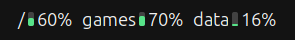
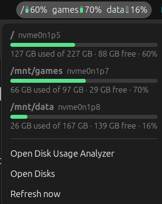

# Disk Space Indicator

A small GNOME Shell extension that keeps an eye on your partitions from the top bar.



Each mounted partition gets a mini gauge and its percentage used. Click it for the details:



## Features

- One mini bar per partition: green below 80%, yellow from 80%, red from 90%.
- Menu with used / total / free for each partition.
- Click a partition in the menu to open it in Files.
- Shortcuts to Disk Usage Analyzer (baobab) and Disks.
- Partitions are detected automatically: every local `/dev/*` partition of 1 GB or more.
  Mount a new disk and it shows up on the next refresh.
- Refreshes every 30 seconds and whenever the menu opens.

## Built not to freeze the shell

- All reads are asynchronous (`/proc/self/mounts` and `g_file_query_filesystem_info`); no external command is run.
- Snaps, FUSE mounts (cloud drives, AppImages), network shares and optical media are never read,
  because a stuck network or FUSE mount is the classic way to hang a panel applet.
- Percentages follow `df`: used / (used + available), so root-reserved blocks don't count as free.

## Requirements

- GNOME Shell 46 (Ubuntu 24.04). Other versions are untested.

## Install

```bash
git clone https://github.com/abszar/disk-space-indicator.git
cd disk-space-indicator
scripts/install.sh
```

The script symlinks the folder into `~/.local/share/gnome-shell/extensions/` and enables the extension.
GNOME Shell only notices a new extension after a restart:

- X11: press Alt+F2, type `r`, press Enter.
- Wayland: log out and back in.

Because it is a symlink, `git pull` plus a shell restart is enough to update.

## Uninstall

```bash
gnome-extensions disable disk-space-indicator@abszar.github.io
rm ~/.local/share/gnome-shell/extensions/disk-space-indicator@abszar.github.io
```

## Development

```bash
gjs -m tests/lib.test.js                                  # unit tests for the pure logic
journalctl --user -b -g disk-space-indicator              # extension logs
```

- `lib.js`: pure logic (mount filtering, percentages, formatting), no GNOME imports, testable with plain `gjs`.
- `extension.js`: the panel button, menu and refresh loop.
- `stylesheet.css`: colors and sizes.

## License

MIT
